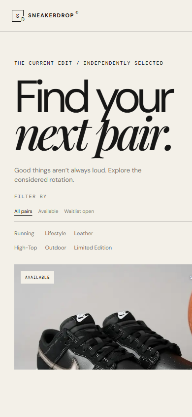

# SneakerDrop

SneakerDrop is a premium, editorial-style sneaker catalogue for discovering independent releases. The project demonstrates a complete database-backed product showcase with protected product management and a product-specific waitlist. It intentionally does not implement checkout or payments.

**Public repository:** [github.com/riyasisodiya2486/SneakerDrop](https://github.com/riyasisodiya2486/SneakerDrop)  
**Deployment:** Not deployed yet. A public website URL will be added here after deployment is configured and verified.

> **Current verification:** Supabase returned 12 published products in the latest catalogue read (7 available and 4 unavailable with an open waitlist). The seed defines 15 products; its remaining rows have not been verified in the live database. Lint, TypeScript, tests, and the production build pass locally. Admin CRUD with an authorized account has not been verified. The saved Vercel CLI has no credentials, so no deployment is claimed.

## Features

- Editorial homepage with a featured release and live product data.
- Supabase-backed catalogue with availability, waitlist, and category filters.
- Product detail pages with product imagery, availability, and a product-specific waitlist form.
- Admin sign-in protected by Supabase Auth and a database UUID allowlist.
- Admin dashboard for product creation, editing, publication, availability, and deletion.
- Waitlist submissions stored in Supabase with email normalization, consent validation, and duplicate prevention per product.
- Responsive layout, reduced-motion support, loading feedback, accessible form status messages, and image fallbacks.

## Screenshots

### Homepage — desktop


### Product catalogue — mobile



An admin screenshot is not included because this workspace does not have an authorized administrator session.

## Technology stack

- **Application:** Next.js 15 App Router, React 19, TypeScript.
- **Styling:** Tailwind CSS 4 is configured; the editorial visual system is implemented primarily with custom CSS, transitions, and keyframes.
- **Database and authentication:** Supabase PostgreSQL, Supabase Auth, `@supabase/ssr`, and Supabase JavaScript client.
- **Validation and UI:** Zod and Lucide icons.
- **Images:** Next.js Image with approved Unsplash and Pinterest CDN hosts.

## Architecture and technical decisions

- App Router server pages fetch published products from Supabase at request time. Product data is not hardcoded or mocked.
- Public catalogue reads use the Supabase publishable key and rely on row-level security. No service-role key is used by the application.
- Admin API routes validate the current Supabase Auth user and confirm that their UUID is in `administrator_allowlist`. Database RLS enforces administrator permissions again.
- The browser cannot insert waitlist rows directly. It calls the `join_waitlist()` PostgreSQL function, which validates eligibility and consent, normalizes the email, and relies on a unique constraint to reject duplicate signups for the same product.
- `available` and `waitlist_open` are separate product fields. The first controls release availability; the second controls whether release updates can be requested.
- Product images are hosted externally. Only HTTPS URLs from `images.unsplash.com` and `i.pinimg.com` are allowed by the app's image configuration and admin validation.
- CSS motion is progressive enhancement: content remains visible with reduced motion or when the motion observer is unavailable.

## Database schema and setup

The SQL files are in [`supabase/`](supabase/):

- [`migrations/202610290001_initial_schema.sql`](supabase/migrations/202610290001_initial_schema.sql) creates `products`, `waitlist_entries`, and `administrator_allowlist`, enables RLS, and defines `join_waitlist()` and admin authorization helpers.
- [`seed.sql`](supabase/seed.sql) inserts the 15 catalogue products. It uses `ON CONFLICT (slug) DO NOTHING` so rerunning it does not overwrite existing product edits.
- [`update_product_images.sql`](supabase/update_product_images.sql) updates the selected image URLs for existing products without replacing other product fields.

To provision a Supabase project:

1. Open the Supabase SQL Editor for your project.
2. Run the migration file, then run `supabase/seed.sql`.
3. If you need the current image updates on existing rows, run `supabase/update_product_images.sql`.
4. Verify the product count:

```sql
select
  count(*) as total_products,
  count(*) filter (where published) as published_products
from public.products;
```

The seed contains 15 products, but the live database was last verified with 12 published products. Running the seed should insert rows whose slugs are not already present; verify the count afterward.

### Administrator provisioning

1. Create an administrator user in Supabase **Authentication → Users**.
2. Copy the Auth user's UUID.
3. As the project owner, add the UUID in the SQL Editor:

```sql
insert into public.administrator_allowlist (user_id)
values ('YOUR-AUTH-USER-UUID')
on conflict (user_id) do nothing;
```

4. Sign in at `/admin/login` using that Auth account. Public sign-up is not exposed, and user-editable metadata does not grant administrator access.

### Row-level security

- Anonymous and authenticated visitors can read published products.
- Product mutations and waitlist review require an authenticated allowlisted administrator.
- Waitlist rows cannot be selected or inserted directly by public clients. Public submissions go through `join_waitlist()`.
- The allowlist policy lets a signed-in user confirm only their own membership; it does not allow users to add themselves.

## Local development

Requirements: Node.js 22+ and npm.

```powershell
npm install
```

Create `.env.local` in the project root. `.env.example` is a template only; do not put secret keys in the browser or commit `.env.local`.

```dotenv
NEXT_PUBLIC_SUPABASE_URL=https://your-project.supabase.co
NEXT_PUBLIC_SUPABASE_PUBLISHABLE_KEY=your-supabase-publishable-key
```

Apply the database migration and seed, then start the app:

```powershell
npm run dev
```

The site runs at `http://localhost:3000`. The admin page is at `/admin/login`.

## Verification

```powershell
npm run lint
npm run typecheck
npm test
npm run build
```

Latest local checks: lint passed, TypeScript passed, all 4 tests passed, and the production build passed. Public catalogue reads, waitlist submission/duplicate handling, product image delivery, and catalogue filters have been checked against the configured Supabase project. Successful administrator CRUD still needs an authorized administrator account for an end-to-end run.

## Deployment

**Deployment URL: pending.** This repository is public, but this workspace has no valid Vercel credentials yet. To deploy:

1. Sign in to Vercel or run `vercel login` in a terminal where you can complete the interactive login.
2. Import [the GitHub repository](https://github.com/riyasisodiya2486/SneakerDrop) into Vercel, or link it with the Vercel CLI.
3. Set `NEXT_PUBLIC_SUPABASE_URL` and `NEXT_PUBLIC_SUPABASE_PUBLISHABLE_KEY` in the Vercel project environment for the deployment targets.
4. Deploy, then verify the public catalogue, waitlist, and administrator login.
5. Replace the pending deployment status at the top of this README with the verified website URL.

## Known limitations

- No cart, checkout, payment processing, or transactional email delivery. Waitlist addresses are stored; signup success is shown in the site.
- No shared rate-limit service is configured for public waitlist submissions.
- Images are externally hosted; replace them with owned or properly licensed brand photography before commercial use.
- The admin product editor accepts image URLs but does not upload or manage image files.
- Waitlist entries are retained when a product is deleted for audit/history. Define a retention and deletion process before collecting real customer data.
- Admin sign-in and CRUD have not been verified with an allowlisted account in this workspace.
