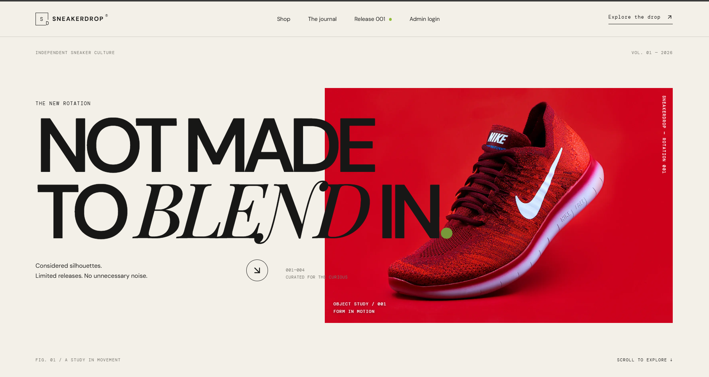
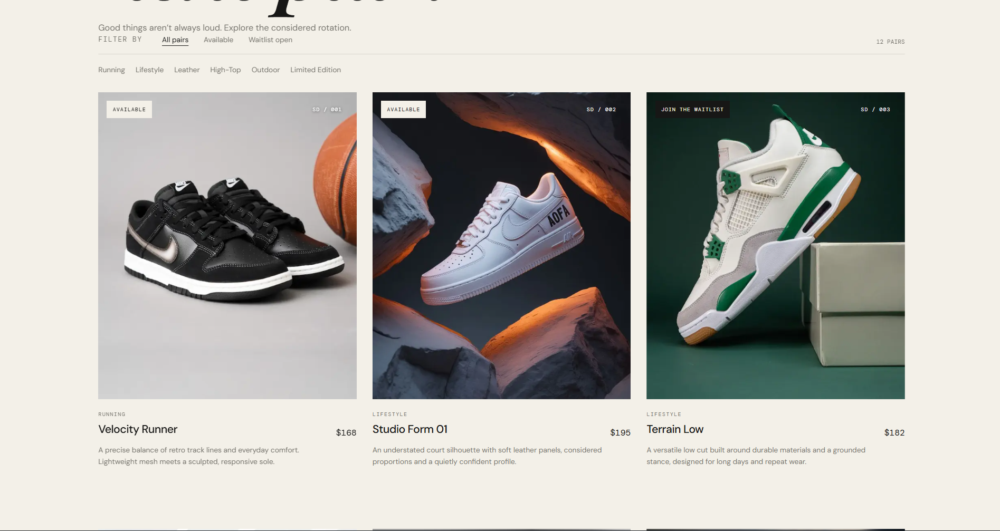
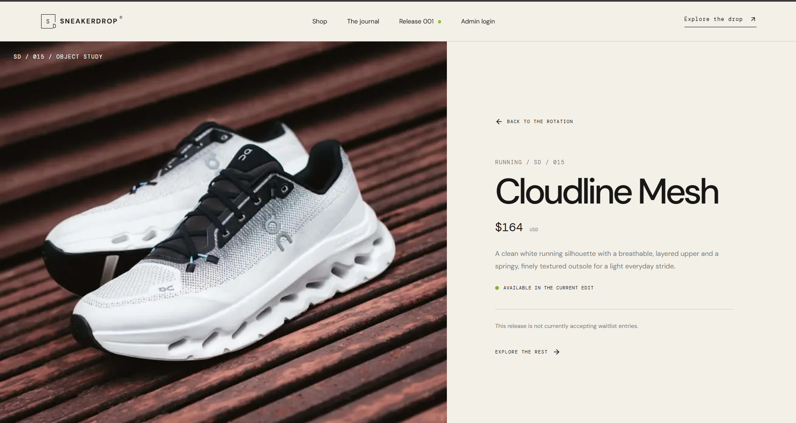
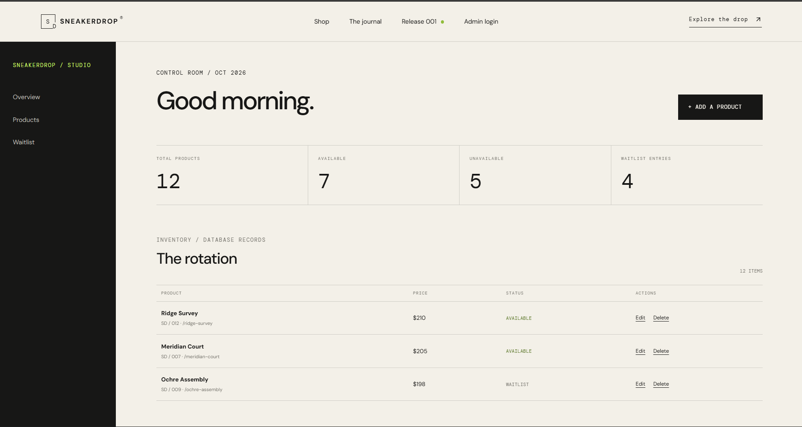

# SneakerDrop

**SneakerDrop** is a premium, editorial-style sneaker discovery and release waitlist platform built around curated footwear collections. It combines an art-directed storefront, a database-driven product catalogue, product-specific waitlist registration, and a protected administration dashboard.

The platform is designed to make sneaker releases feel like curated product drops rather than entries in a conventional e-commerce catalogue.

**Live Website:** https://sneaker-drop-kappa.vercel.app/

**GitHub Repository:** https://github.com/riyasisodiya2486/SneakerDrop

---

## Design Philosophy

SneakerDrop follows a contemporary sneaker-editorial direction, combining minimal layouts with bold product presentation.

The visual identity uses warm ivory surfaces, ink-charcoal typography, restrained accent colors, oversized editorial headings, carefully composed product imagery, and subtle motion. Rather than relying on conventional e-commerce layouts, the interface gives individual sneaker releases visual prominence through spacious compositions and a strong typographic hierarchy.

The design balances a distinctive visual identity with practical usability. Responsive layouts adapt across desktop and mobile screens, while transitions, navigation feedback, and scroll-based reveals add depth without overwhelming the content. Reduced-motion preferences are respected throughout the experience.

## Features

### Storefront and Product Discovery

- Editorial landing page featuring curated sneaker releases.
- Dynamic product catalogue retrieved from Supabase PostgreSQL.
- Product cards with images, pricing, categories, and release information.
- Individual product detail pages.
- Category and availability filters.
- Separate product states for publication, availability, and waitlist eligibility.
- Responsive navigation and mobile-friendly layouts.

### Product Waitlist

- Product-specific email registration.
- Email normalization and validation.
- Consent validation before submission.
- Database-enforced duplicate prevention for the same email and product.
- Persistent waitlist records stored in Supabase.
- Clear feedback for successful and duplicate submissions.

### Administrator Dashboard

- Protected administrator authentication through Supabase Auth.
- Database-backed administrator allowlist.
- Create, edit, publish, and delete sneaker products.
- Update product pricing, descriptions, categories, and image URLs.
- Toggle product availability and waitlist eligibility.
- Review waitlist submissions from the administration interface.
- Persistent changes backed by Supabase PostgreSQL.

### Interface and Accessibility

- Responsive desktop and mobile experience.
- Custom CSS animations and transitions.
- Scroll-triggered content reveals.
- Reduced-motion support.
- Accessible form status messages and validation feedback.
- Image fallbacks and loading states.

## Screenshots

### Landing Page


### Product Catalogue


### Product Details


### Admin Dashboard


## Technology Stack

| Area | Technology |
|---|---|
| Framework | Next.js 15 App Router |
| UI Library | React 19 |
| Language | TypeScript |
| Styling | Tailwind CSS 4, Custom CSS |
| Backend | Next.js server-side routes and server components |
| Database | Supabase PostgreSQL |
| Authentication | Supabase Auth |
| Database Security | PostgreSQL Row-Level Security (RLS) |
| Validation | Zod |
| Icons | Lucide |
| Image Delivery | Unsplash and Pinterest image CDNs |
| Deployment | Vercel |
| Version Control | Git and GitHub |

## Database Model and Access Policies

The database schema is maintained in the `supabase/` directory.

The application uses three primary tables.

### `public.products`

Stores the sneaker catalogue and release information.

| Column | Type | Purpose |
|---|---|---|
| `id` | UUID | Primary key |
| `name` | TEXT | Product name |
| `slug` | TEXT | Unique product URL identifier |
| `description` | TEXT | Product description |
| `price` | NUMERIC | Product price |
| `image_url` | TEXT | Product image URL |
| `category` | TEXT | Product category |
| `available` | BOOLEAN | Current availability |
| `published` | BOOLEAN | Public catalogue visibility |
| `waitlist_open` | BOOLEAN | Controls waitlist registration |
| `release_code` | TEXT | Release identifier |
| `created_at` | TIMESTAMPTZ | Creation timestamp |
| `updated_at` | TIMESTAMPTZ | Last update timestamp |

### `public.waitlist_entries`

Stores customer interest in individual sneaker releases.

| Column | Type | Purpose |
|---|---|---|
| `id` | UUID | Primary key |
| `product_id` | UUID | Product reference |
| `former_product_id` | UUID | Preserved product reference for historical entries |
| `email` | TEXT | Normalized email address |
| `consented_at` | TIMESTAMPTZ | Consent timestamp |
| `created_at` | TIMESTAMPTZ | Submission timestamp |

A unique constraint on `(former_product_id, email)` prevents duplicate registrations for the same product.

### `public.administrator_allowlist`

Controls which authenticated Supabase users can access administrative functionality.

| Column | Type | Purpose |
|---|---|---|
| `user_id` | UUID | References `auth.users(id)` |
| `created_at` | TIMESTAMPTZ | Allowlist entry timestamp |

### Database Functions

The migration defines supporting PostgreSQL functions:

- `join_waitlist()` — Processes public waitlist registrations, validates eligibility and consent, normalizes email addresses, and handles duplicate prevention.
- `is_sneaker_admin()` — Checks whether an authenticated user belongs to the administrator allowlist.
- `touch_updated_at()` — Maintains product update timestamps.

### Security and Row-Level Security

Row-Level Security is enabled on the application tables.

- Public visitors can read published products.
- Product mutations require an authenticated allowlisted administrator.
- Waitlist records are not directly readable by public clients.
- Public waitlist registration is handled through the controlled `join_waitlist()` database function.
- Administrator authorization is checked at the application level and reinforced by database policies.
- The application uses the Supabase publishable key for public-facing access; the service-role key is not exposed to the browser.

## Database Setup

The repository contains the following SQL files:

```text
supabase/
├── migrations/
│   └── 202610290001_initial_schema.sql
├── seed.sql
└── update_product_images.sql
```

### Provisioning a Supabase Project

1. Create a Supabase project.
2. Open the project's SQL Editor.
3. Execute `supabase/migrations/202610290001_initial_schema.sql`.
4. Execute `supabase/seed.sql` to populate the initial product catalogue.
5. Optionally execute `supabase/update_product_images.sql` to apply the selected image URL updates.
6. Verify the product records.

The seed file defines 15 initial sneaker products. It uses `ON CONFLICT (slug) DO NOTHING`, preserving existing product edits when executed again.

Verify the catalogue using:

```sql
SELECT
    COUNT(*) AS total_products,
    COUNT(*) FILTER (WHERE published) AS published_products,
    COUNT(*) FILTER (WHERE available) AS available_products,
    COUNT(*) FILTER (
        WHERE NOT available AND waitlist_open
    ) AS waitlist_open_products
FROM public.products;
```

## Local Development

### Requirements

- Node.js 22 or newer
- npm
- A Supabase project

### Installation

Clone the repository:

```bash
git clone https://github.com/riyasisodiya2486/SneakerDrop.git
cd SneakerDrop
```

Install dependencies:

```bash
npm install
```

### Environment Variables

Create a `.env.local` file in the project root:

```dotenv
NEXT_PUBLIC_SUPABASE_URL=https://your-project.supabase.co
NEXT_PUBLIC_SUPABASE_PUBLISHABLE_KEY=your-supabase-publishable-key
```

Replace the placeholder values with your Supabase project credentials.

The publishable key is intended for client-facing Supabase access and is protected by the database's RLS policies.

Never commit `.env.local` or expose privileged credentials in frontend code or the public repository.

### Run the Application

Start the development server:

```bash
npm run dev
```

Open the application at:

```text
http://localhost:3000
```

The administrator login is available at:

```text
http://localhost:3000/admin/login
```

### Production Build

```bash
npm run build
npm start
```

## Admin Authentication and Evaluator Access

The administration dashboard uses Supabase Authentication rather than a publicly accessible shared-password mechanism.

Administrator access is controlled through the `administrator_allowlist` table. An authenticated user must have their Supabase Auth UUID registered in this table before they can perform administrative operations.

### Provisioning an Administrator

1. Create the administrator account through Supabase Dashboard → Authentication → Users.
2. Copy the user's UUID.
3. Add the UUID to the administrator allowlist:

```sql
INSERT INTO public.administrator_allowlist (user_id)
VALUES ('YOUR-AUTH-USER-UUID')
ON CONFLICT (user_id) DO NOTHING;
```

4. Sign in using the account at `/admin/login`.

Public administrator registration is not exposed. User-editable metadata cannot grant administrator permissions.

**Evaluator note:** Share temporary evaluator credentials privately through the submission process. Never commit account passwords to this public repository, and rotate temporary credentials after evaluation.

## Deployment

SneakerDrop is deployed on Vercel.

**Production URL:** https://sneaker-drop-kappa.vercel.app/

To deploy another instance:

1. Import the GitHub repository into Vercel.
2. Configure the required Supabase environment variables.
3. Ensure the database migration and seed have been executed.
4. Deploy the application.
5. Verify catalogue retrieval, waitlist registration, and administrator access.

Required Vercel environment variables:

```dotenv
NEXT_PUBLIC_SUPABASE_URL
NEXT_PUBLIC_SUPABASE_PUBLISHABLE_KEY
```

## Testing and Verification

The project includes automated tests and application-level checks.

Run the available checks:

```bash
npm run lint
npm run typecheck
npm test
npm run build
```

The latest recorded local verification reported successful linting, TypeScript checks, four automated tests, and a production build.

Previously tested functional flows include:

- Public product retrieval.
- Product availability filtering.
- Waitlist registration and email normalization.
- Duplicate waitlist rejection.
- Invalid email and missing consent rejection.
- Unauthorized administrative access restrictions.

Successful administrator CRUD should be checked using the provisioned reviewer account.

## Project Structure

```text
SneakerDrop/
├── public/                  Static assets
├── src/
│   ├── app/                 App Router pages and routes
│   │   ├── admin/           Administrator pages
│   │   ├── products/        Product detail routes
│   │   └── shop/            Product catalogue
│   ├── components/          Reusable UI components
│   └── lib/                 Supabase clients and utilities
├── supabase/
│   ├── migrations/          Database schema and policies
│   ├── seed.sql             Initial product data
│   └── update_product_images.sql
├── .env.example
├── package.json
└── README.md
```

## Current Scope and Limitations

- The application focuses on product discovery and release waitlists; checkout and payment processing are not implemented.
- Waitlist submissions are persisted, but transactional email notifications are not configured.
- A distributed rate-limiting service is not currently configured for public waitlist submissions.
- Product images are externally hosted and depend on their respective image providers.
- The administrator product editor accepts image URLs rather than supporting direct image uploads.
- Waitlist records are retained for historical tracking when a product is deleted. A formal data-retention and deletion policy should be established before commercial use.

## Future Enhancements

- Transactional email notifications for release announcements.
- Product image uploads and managed storage.
- Distributed rate limiting and additional abuse protection.
- Inventory tracking and scheduled product releases.
- Product engagement and waitlist analytics.

## Author

**Riya Sisodiya**

B.Tech — Computer Science and Information Technology
---

*SneakerDrop — Curated releases. Distinct identity.*
